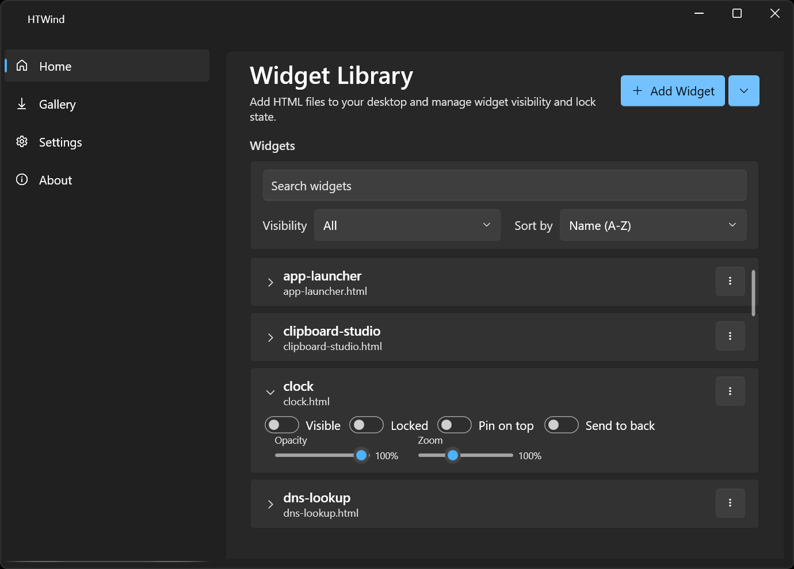
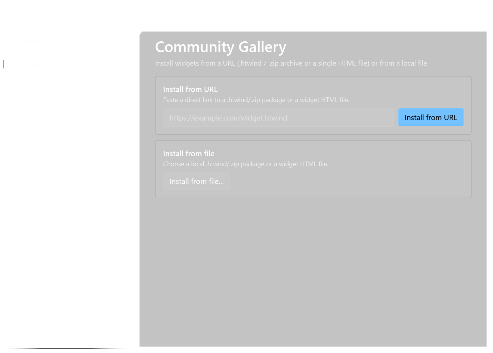
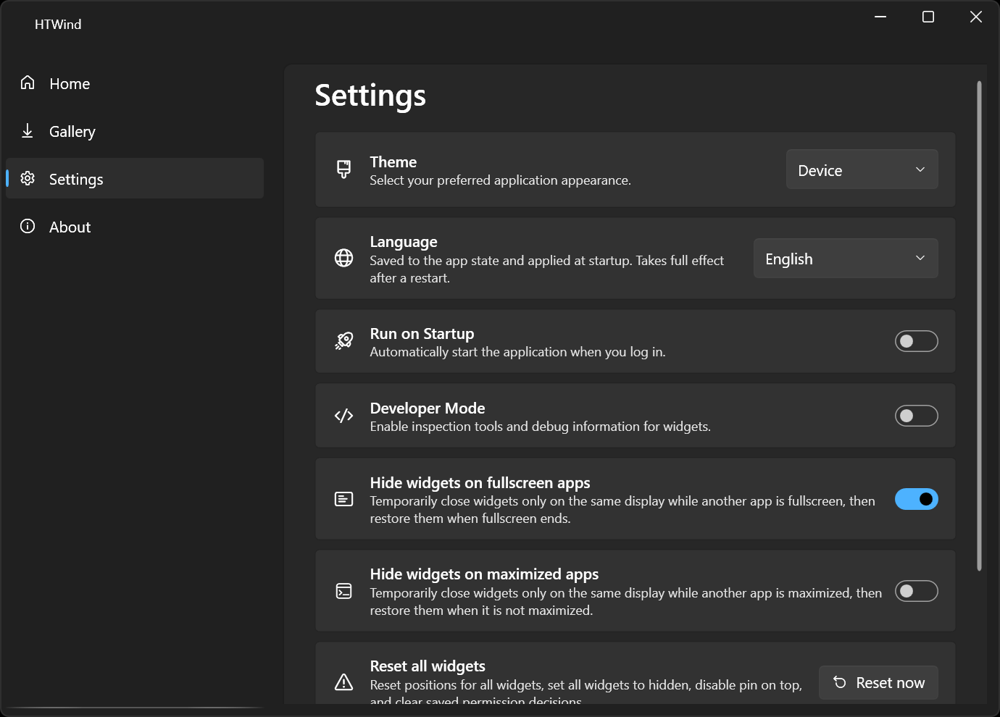

# HTWind

HTWind is a highly customizable, HTML-based widget manager that brings your favorite web tools and system helpers directly to your Windows desktop.
Widgets can call fast in-process host APIs for system metrics, real-time audio, media control, storage, and theming — and can still run PowerShell commands when you explicitly allow it.

[Website](https://htwind.vercel.app)

<a href="https://apps.microsoft.com/detail/9PN58CG1P20L?referrer=appbadge&cid=sametcn99&mode=full" target="_blank"  rel="noopener noreferrer">
 
</a>

## Screenshots

<p align="center">
 
 <br/>
 <i>Widget Library - Manage and toggle HTML widgets</i>
</p>

<p align="center">
 
 <br/>
 <i>Gallery - Install widgets from a URL or local package</i>
</p>

<p align="center">
 
 <br/>
 <i>Settings - Theme, language, and startup configuration</i>
</p>

## Highlights

- **Native host bridge APIs: `system.metrics`, `audio.visualizer`, `media.session`, `storage.get/set`, `theme.get/onChanged`** — zero-process, real-time data for widgets
- **Per-widget PowerShell permission prompt (Read-only / Full access / Deny)** with a sandboxed read-only mode and manifest `requirements` support
- In-process PowerShell engine (transient runspace per call) — no `powershell.exe` process spawn per command, with per-call timeouts
- Desktop HTML widgets with lock/unlock interaction modes
- Desktop-layer pinning ("send to back", above desktop icons) in addition to pin-on-top
- Magnetic window snapping to screen edges, other widgets, and center guides while dragging
- Per-widget opacity (20–100%) and zoom (50–200%) controls, persisted per widget
- Workspace profiles: save and switch widget layouts (e.g. Work / Game / Stream) from the tray menu
- Import widget packages through `htwind.widget.json`
- Support for widgets with local assets such as CSS, JavaScript, images, and fonts
- Support for multi-widget packages that install several widgets from one manifest
- Built-in widget library (clock, weather, system tools, file helpers, and more) with version-based template updates
- **Multi-file tabbed code editor** (offline Monaco) with live preview (hot reload) and a runtime console/error panel
- **Widget settings forms**: declare a `settingsSchema` in the manifest and users configure your widget without touching code
- **In-app community gallery**: install widgets from a URL or a local `.htwind`/`.zip` package
- Tray integration (show/hide app, background workflow, workspace profiles)
- Visibility toggle and persisted widget geometry/state
- Smart visibility suppression by display: hide widget windows while another app is fullscreen (toggle)
- Optional maximized-window suppression by display (separate toggle from fullscreen suppression)
- Persistent app theme and UI language, restored on launch
- Atomic state files: widget state, permissions, and settings survive crashes and power loss
- Startup toggle (`HKCU\Software\Microsoft\Windows\CurrentVersion\Run`)
- Localization infrastructure (`resx` + `LocExtension`)
- Open-source and community-driven development

## Visibility Suppression Modes

HTWind includes per-display runtime suppression options in **Settings** to reduce distraction and improve performance while other apps are in focus.

- **Hide widgets on fullscreen apps** (enabled by default):
Widget windows are hidden and their WebView2 is suspended on the same display when another app enters fullscreen, then restored instantly when fullscreen ends. The widget's in-page state survives the transition.
- **Hide widgets on maximized apps** (optional):
Widget windows are hidden and suspended on the same display when another app is maximized, then restored when that app is no longer maximized.

Notes:

- These options do not change the widget `Visible` state in app data.
- Suppression is runtime-only, event-driven (no background polling loops), and windows are restored automatically.

## Workspace Profiles

Save the current widget layout — which widgets are visible, their positions, sizes, lock/pin modes, opacity, and zoom — as a named profile from the tray menu. Switch between profiles (for example "Work", "Game", and "Stream") to reapply a complete desktop setup in one action. Profiles can be deleted from the same menu when no longer needed.

## Community Gallery

The in-app **Gallery** page replaces the old external "Find More" link. You can:

- Install a widget from a URL: a `.htwind`/`.zip` archive or a single HTML file
- Install from a local archive or HTML file on disk

Archives are extracted and imported through their `htwind.widget.json` manifest; plain HTML files are imported directly. Downloaded widgets are ordinary widgets: they only request permissions (such as PowerShell execution) if and when they actually use them.

## Share Widgets and Feedback With The Community

Use GitHub Discussions and the HTWind Reddit community to share reusable widgets, desktop setups, bug reports, and feature requests.

- GitHub Discussions: <https://github.com/sametcn99/HTWind/discussions>
- Reddit: <https://www.reddit.com/r/HTWind/>

## Installation

Recommended for most users: install HTWind using the installer executable from GitHub Releases (`HTWind-setup-<version>.exe`).
Portable ZIP and Microsoft Store installation are available as alternatives.

### Option 1: From GitHub Releases (recommended)

1. Open `Releases` in this repository.
2. Download one of the assets:

- `HTWind-setup-<version>.exe` (installer, recommended)
- `HTWind-portable-<version>.zip` (portable alternative)

1. For installer mode, run the setup executable and follow the wizard.

### Option 2: Run from source

Prerequisites:

- Windows 10/11
- .NET SDK 10.0+

Commands:

```powershell
dotnet restore HTWind/HTWind.csproj
dotnet build HTWind/HTWind.csproj
dotnet run --project HTWind/HTWind.csproj
```

## Uninstallation

If you are using the installed version of HTWind, you can uninstall it from **Windows Settings > Apps > Installed apps**.

> [!IMPORTANT]
> Uninstalling HTWind will delete all widgets and data stored in `%LocalAppData%\HTWind`. If you are uninstalling the app to perform a clean update, make sure to take a backup of this folder before proceeding.

## Widget Development

You can build custom widgets using plain HTML/CSS/JavaScript.

HTWind now supports three practical widget packaging levels:

- A single HTML file for the fastest possible prototype
- A widget folder with additional local assets such as CSS, JavaScript, images, or fonts
- A manifest-driven package using `htwind.widget.json`, which can describe one widget or multiple widgets in one importable bundle

### Widget Package Manifests

Use `htwind.widget.json` when your widget is made of more than one file or when you want to distribute multiple widgets together.

This package format is useful when you want to:

- Keep your widget code split across `index.html`, `styles.css`, `app.js`, and other local assets
- Ship several related widgets as one reusable desktop toolkit
- Export a single managed widget from HTWind as a portable package
- Export the current workspace as a manifest-based bundle for backup or team sharing

HTWind includes a schema and an example package in the repository:

- Schema: [HTWind/Templates/htwind.widget.schema.json](HTWind/Templates/htwind.widget.schema.json)
- Example multi-widget package: [HTWind/Templates/examples/multi-widget-package/htwind.widget.json](HTWind/Templates/examples/multi-widget-package/htwind.widget.json)

### Manifest Structure

The manifest describes package metadata and a `widgets` array. Each widget entry points to a relative folder, an entry HTML file, and the additional asset files that belong to that widget.

Typical fields:

- `schemaVersion`: currently `1`
- `name`: package name
- `description`, `author`, `version`, `homepage`: optional package metadata
- `requirements`: optional capability declaration, e.g. `"powershell": "readonly" | "full" | "none"`
- `settingsSchema`: optional user-facing settings declaration (see below)
- `widgets`: one or more widget entries

Each widget entry includes:

- `widgetId`: stable widget identifier inside the package
- `name`: display-oriented widget name
- `relativePath`: folder path relative to the manifest root
- `entryFile`: the widget HTML entry point
- `assets`: non-entry files that should travel with the widget

Example:

```json
{
  "$schema": "../../htwind.widget.schema.json",
  "schemaVersion": 1,
  "name": "multi-widget-package",
  "description": "Example package that contains two widgets in a single manifest.",
  "widgets": [
    {
      "widgetId": "status-board-widget",
      "name": "status-board",
      "relativePath": "widgets/status-board",
      "entryFile": "index.html",
      "assets": ["styles.css", "app.js"]
    },
    {
      "widgetId": "focus-timer-widget",
      "name": "focus-timer",
      "relativePath": "widgets/focus-timer",
      "entryFile": "index.html",
      "assets": ["styles.css", "app.js"]
    }
  ]
}
```

### Recommended Folder Layout

For widgets that use multiple files, keep the manifest at the package root and place each widget in its own folder.

```text
my-widget-package/
├─ htwind.widget.json
└─ widgets/
   ├─ status-board/
   │  ├─ index.html
   │  ├─ styles.css
   │  └─ app.js
   └─ focus-timer/
      ├─ index.html
      ├─ styles.css
      └─ app.js
```

This structure keeps packages predictable, easy to validate, and easy to export or import again later.

### Import and Export Workflow

HTWind supports both creator and consumer workflows:

- Import a standalone HTML file when you only need a simple single-file widget
- Import `htwind.widget.json` when the widget depends on local assets or the package includes multiple widgets
- Install packages directly in the app through the Gallery page (URL or local file)
- Export a widget from the widget context menu to create a reusable package folder
- Export the current workspace from Settings to create a package-oriented backup of your active widget setup

Exports are scoped strictly to each widget's own entry file and declared/referenced assets — widgets that share a folder never leak sibling files into a package.

When HTWind imports a manifest package, it copies the widget content into managed storage and preserves the package structure needed for the widget entry file and assets to work together.

### When to Use Single Files vs Manifests

Use a single HTML file when:

- You are prototyping quickly
- The widget is small and self-contained
- You want the simplest sharing format possible

Use `htwind.widget.json` when:

- Your widget depends on local CSS or JavaScript files
- You want to include images, icons, or other static assets
- You need to share several widgets together
- You want a package that is easier to evolve, validate, and re-export

### Widget Settings Schema

Add a `settingsSchema` to your manifest and HTWind renders a settings form for your widget automatically (widget context menu → Widget settings). No code editing required for your users.

Each field supports:

- `key`: the setting key saved for the widget
- `label`: the visible form label
- `type`: `text`, `number`, `toggle`, or `select`
- `default`: the initial value
- `options`: list of choices for `select` fields

Saved values are persisted in the widget's own folder and injected into the widget document as `window.HTWind.__settings` on every load, plus a `htwindsettings` event when they change. Widgets typically combine this with `storage.get`/`storage.set` for their own additional state.

### Host Bridge API

Widgets call host APIs through `window.HTWind.invoke(command, args)`, which returns a Promise.

Available commands:

#### `system.metrics`

Zero-process system telemetry. Returns CPU load, memory usage, disk usage per drive, network RX/TX throughput, battery status, uptime, and process count.

#### `audio.visualizer`

Real-time audio analysis from the default output device (WASAPI loopback + FFT). Args: `bands` (4–64, default 16). Returns `peakLevel`, `rmsLevel`, `isSilent`, and the `bands` array. Capture starts lazily and stops after 8 seconds without requests.

#### `media.session`

Windows media control (GSMTC): now-playing title/artist/album, playback status, position, album art (as a data URL), and transport controls. Args: `action` (`get`, `play`, `pause`, `toggle`, `next`, `previous`) and `includeArt`.

#### `storage.get` / `storage.set`

Persistent per-widget JSON storage in the widget's own folder (survives WebView2 profile resets). `storage.get` takes an optional `key` (returns the whole object when omitted); `storage.set` takes `key` and `value`.

#### `theme.get` / `theme.onChanged`

Returns `{ appTheme, systemTheme, accentColor, isDark }`. Theme changes are pushed live into widget pages: listen for the `htwindtheme` event to restyle your widget when the app or Windows theme changes.

#### `powershell.exec`

Runs a PowerShell script through the embedded in-process engine (one transient runspace per call — no process spawn, full per-call isolation). Supported args:

- `script` (required)
- `timeoutMs` (500–120000, default 5000)
- `maxOutputChars`
- `shell` (accepted for compatibility; execution always uses the embedded engine)
- `workingDirectory`

The response contains `timedOut`, `exitCode`, `output`, `error`, `outputTruncated`, `errorTruncated`, and `workingDirectory`. Output is clipped by `maxOutputChars` for safety.

**Per-widget permission required:** the first time a widget calls `powershell.exec`, HTWind asks you to grant Read-only, Full access, or Deny for that widget, and remembers the decision. A manifest can pre-declare its needs with `"requirements": { "powershell": "readonly" | "full" | "none" }`.

- **Read-only** runs in a sandbox: Constrained Language mode, a read-only cmdlet allowlist (write primitives such as `Out-File` or `Set-Content` are removed), and module auto-loading disabled.
- **Full access** runs unrestricted scripts.
- **Deny** blocks PowerShell execution for the widget.

Notes for all commands:

- Every call has a client-side watchdog so a failed host call can never leak a promise forever.
- Widgets also receive their settings via `window.HTWind.getSettings()`.

### Generate Widgets With LLM Help

If you want AI assistance while creating widgets, use the dedicated HTWind system prompt:

- [HTWind Widget Generator Prompt](chat.prompt.md)
- [HTWind Widget Generator Prompt (shared)](https://prompts.chat/prompts/cmm5broas0004li04ku12tp56_htwind-widget-creator)

You can copy this prompt into your preferred LLM and ask it to generate HTWind-compatible widgets (including host bridge usage) as a single HTML file.

For larger widgets, a good workflow is to start with a single-file prototype, then split the widget into `index.html`, `styles.css`, `app.js`, and other assets before adding a `htwind.widget.json` manifest for packaging and sharing. The built-in editor opens every editable file of a package in its own tab and shows runtime `console` output and script errors in a console panel.

### Security and Responsibility Notice

- Widgets can request PowerShell execution via `powershell.exec`; each widget needs an explicit per-widget grant (Read-only / Full / Deny), and the choice is persisted.
- Read-only mode is a best-effort sandbox (Constrained Language + allowlist). It cannot block launching ordinary executables that ship with Windows or the user's PATH.
- Running commands can modify files, processes, registry entries, and network/system settings.
- All command execution risk is owned by the user running HTWind.
- On first launch, HTWind requires explicit acceptance of this risk before the app opens.

## Contributing

See [CONTRIBUTING.md](CONTRIBUTING.md) for the full contribution guide.

## Support

- Issues: <https://github.com/sametcn99/HTWind/issues>
- Discussions: <https://github.com/sametcn99/HTWind/discussions>
- Reddit community: <https://www.reddit.com/r/HTWind/>

If you find a bug, please include reproduction steps, expected behavior, and environment details.

## License

This project is licensed under the GPL-3.0 License. See the [LICENSE](LICENSE) for details.
